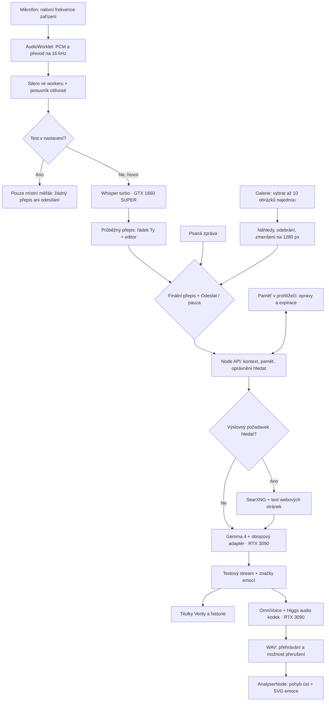

# Verity 🟡

**Lokální AI postavička, která tě slyší, mluví na tebe a nechce, abys odešel.**

Zářící žlutý smajlík v tmavém okně prohlížeče inspirovaný entitou *Verity* z hororové ARG série **„Something“** od ThatMob. Odpovídá přes lokální LLM, mluví vlastním hlasem s lip syncem, poslouchá mikrofon, promítá emoce do animovaného obličeje, pamatuje si tě napříč dny – a s rostoucí „nestabilitou“ sklouzává od milé pomocnice k majetnické posedlosti.

### ▶ Vyzkoušej: **[opicebot.cz/verity](https://opicebot.cz/verity/)**

LLM, přepis i hlas běží na vlastním hardwaru. Hledání na internetu používá samostatnou vyhledávací službu a veřejné webové stránky.

> Fanouškovský projekt. Postava Verity a série „Something“ patří ThatMob; tento projekt s ním nijak nesouvisí.

---

## Co umí

- **Titulky i přepis současně** – pod postavou jsou řádky Verity / Ty. Poslední výměna zůstává vidět po domluvení; úplnou historii otevře Přepis.
- **Místní test citlivosti** – otevření nastavení zapne mikrofon jen pro měřák dBFS, pravděpodobnosti řeči a živý práh. Žádný zvuk z testu nejde do Whisperu či Verity; zavřením se mikrofon uvolní.
- **Automatický diagnostický log** – správce může načíst nové rozhovory, emoce, hledání a přehrávání přes chráněný endpoint bez ručního exportu. Retence sedm dní, bez souborů audia a obrázků. [Přístup a provoz](docs/DIAGNOSTIKA.md).
- **Emoce podle obsahu** – výsledky hledání a fotky dostávají vlastní výraz; tragické zprávy mají střídmé podání bez úsměvu. [Popis a ověření](docs/EMOCE-PODLE-OBSAHU.md).
- **Rozsvícená obrazovka** – Verity automaticky brání zhasnutí po celou dobu, kdy je její stránka viditelná, i bez hovoru a před úvodním tlačítkem. Při skrytí se zámek uvolní; po návratu se obnoví. Závisí na podpoře prohlížeče a rozhodnutí systému.
- **Stav práce** – poslouchání, přepis, přemýšlení, hledání, mluvení, dokončení a chyba.

- **Anime výrazy a gesta** – 29 emocí včetně komického uražení, sedm pomalejších nálad, hvězdičkové/srdíčkové oči, kapičky, ruměnec, úleky a pružné pohyby. Gesta začínají s přehrávanou větou. [Úplný seznam emocí](docs/EMOCE.md).
- **Hororové herectví** – zamrzlý úsměv, upřený pohled, nepřirozený náklon, pomalé přiblížení se stínem, praskající maska a viditelné uklidnění. Předloha, chování a skutečné simulace: [Hororová Verity](docs/HOROR.md).
- **Sedm klidových animací** – rozhlížení, naklánění, protažení, podřimování, zhoupnutí, pokukování a klidné čekání. Bez automatických zpráv; při aktivitě ustoupí. Živost i idle lze upravit v nastavení.
- **Nestabilita 0–100** – čtyři roleplay fáze: zářící → přilnavá → majetnická → rozpadající se. Mění výraz, oči, úsměv a atmosféru. „Mluv normálně“ hororový tón vypne i pro další zprávy; lze jej vrátit v nastavení. V živém režimu Verity po ukončení sama nepromlouvá a neblokuje odchod ze stránky.
- **Hlas a lip sync** – každá věta se syntetizuje zvlášť (další se generuje, zatímco předchozí hraje); pusa se hýbe podle skutečného audia (hlasitost + spektrum → otevření a zakulacení).
- **Mluvení jako hlavní způsob ovládání** – průběžný hovor s Whisperem, odesíláním po pauze a hlasovou odpovědí. Starší režimy a ruční odesílání zůstávají dostupné.
- **„Ví věci“** – dostává skutečné signály z prohlížeče: čas, jak dlouho jsi byl pryč, kolikrát jsi odešel ze záložky, jestli je u tebe ticho nebo hluk, teplotu GPU, na které běží („moje tělo“).
- **Adaptativní paměť** – fakta s doložením původu, časem, expirací a opravami. Nové údaje nahrazují staré, dočasné zanikají. Panel Paměť umí ruční úpravy, mazání i zálohu a obnovu.
- **Fotky (vision)** – v galerii lze označit až **10 obrázků najednou**. Další sady lze doplnit, vložit ze schránky nebo přetáhnout; náhledy se dají jednotlivě odebrat. Kamera na telefonu či webkamera na PC přidá další fotku. Model dostane obrázky v pořadí, do historie jdou miniatury.
- **Přemýšlení (reasoning)** – automaticky, vypnuto nebo vždy. Živý hovor v automatickém režimu upřednostňuje rychlost; vnitřní myšlenky se nečtou nahlas. Testy a jejich omezení jsou v docs/ROLEPLAY.md.
- **Internet** – hledá na nový požadavek, jeho přímé potvrzení nebo výslovné zopakování. [Návaznost a ochrana proti planým slibům](docs/NAVAZNE-HLEDANI.md). Server blokuje nevyžádané hledání, kontroluje dokončení a počet výsledků a hlásí skutečné selhání.
- **Mobil** – vstup se drží nad klávesnicí, obličej se přizpůsobí.
- **Podkres** – tlačítko ♪ pustí hudbu (hlasitost a opakování v menu); smajlík se do rytmu jen **jemně houpe** (plynule, ~1× za sekundu, bez skoků a bez blikání), když Verity mluví, hudba se ztlumí. Hudba v repozitáři není – vlož vlastní `public/podkres.mp3`; tempo zjistí `python tools/beats.py public/podkres.mp3` (jinak se počítá se 120 BPM).
- **Bez blikání** – volba v menu vypne glitch efekty a problikávání; houpání i blikání se vypnou samy, když má systém zapnuté omezení pohybu (`prefers-reduced-motion`).

## Hlasový rozhovor

Klikni na **Začít rozhovor**. Mikrofon se spouští až touto akcí; otevření nastavení spustí pouze místní test citlivosti. Výchozí nastavení:

- Průběžný hovor, odeslání po pauze a mluvené odpovědi.
- Silero VAD ve Web Workeru, nastavitelný práh citlivosti.
- V nastavení se automaticky spustí místní měřák mikrofonu: dBFS, detekce řeči a živý posuvník, bez odesílání do Whisperu či Verity. Zavření nastavení mikrofon uvolní.
- Potlačení ozvěny AEC; pokud se nepodaří spustit nebo prohlížeč podporu nepotvrdí, automatické střídání poslechu a řeči.
- Průběžný přepis rozepsané věty. V AEC a sluchátkovém režimu lze odpověď přerušit hlasem; tlačítkem **Chci mluvit** ve všech režimech.
- **Napsat** ukončí poslech a otevře editor. **Přepis** otevře historii bez ukončení hovoru.
- Po dvou minutách ticha nebo skrytí stránky se průběžný hovor ukončí.

Původní nahrávání jednotlivých zpráv, ruční odeslání i opětovné zapnutí mikrofonu po odpovědi zůstaly v nastavení. Nový preset se nastaví jednou; další změny uživatele se nepřepisují. Citlivost mikrofonu zůstává zachována.

Nejde o nativní speech-to-speech model: jde o řetězec **mikrofon → Whisper → Gemma → OmniVoice**. Jednotlivé kroky se průběžně zpracovávají a přehrávání lze přerušit. Kvalita AEC závisí na konkrétním telefonu a prohlížeči.

## Použité AI modely a hardware

| Účel | Model | Běh |
| --- | --- | --- |
| Rozhovor, vidění, paměť, vyhodnocení hledání | Gemma 4 26B A4B IT, varianta ultra-uncensored-heretic, GGUF Q5_K_S + mmproj BF16 | llama.cpp, RTX 3090, kontext 214 272 tokenů, KV cache q4_0, jeden slot |
| Hlas | OmniVoice, základ Qwen3-0.6B, zvukový tokenizér Higgs Audio v2 | PyTorch FP16, RTX 3090, klon z české reference, 32 kroků |
| Přepis řeči | Whisper large-v3-turbo od mobiuslabsgmbh | faster-whisper / CTranslate2, GTX 1660 SUPER ve Windows, int8_float32 |
| Detekce řeči | Silero VAD v5 | ONNX Runtime Web 1.31.1 ve workeru prohlížeče |
| Přepis chybějící TTS reference | Whisper large-v3-turbo, volitelný fallback hlasové služby | CPU, int8; při vyplněném reference_text se nepoužívá |
| Internet | SearXNG a Python extrakce stránek | Samostatná služba; není to další LLM |

**[Přesný inventář modelů, souborů, verzí a technologií](docs/MODELY-A-TECHNOLOGIE.md)** zahrnuje i revize, které se podařilo ověřit, a výslovně označuje nezjištěné údaje.

**Hardware současného nasazení:** RTX 3090 24 GB pro Gemmu a OmniVoice na Ubuntu, GTX 1660 SUPER pro Whisper ve Windows. LLM/STT/TTS váhy a samostatné služby nejsou součástí tohoto GitHubu; přibalené jsou pouze browserové Silero a ONNX Runtime s licencemi.

### Hlas Verity

Základní hlas vznikl v OmniVoice režimem voice design z popisu `female, teenager, high pitch` (seed 4242). Vybraný český vzorek se používá jako reference pro klonování. Emoce upravují tempo; šepot má vlastní referenci `verity_whisper.wav`. Přepisy referencí se předávají výslovně. Hlasové vzorky a osobní nahrávky nejsou publikované v repozitáři.

## Mapa fungování



Přepis mikrofonu se průběžně opravuje. Gemma dostane hotový tah až při odeslání nebo po pauze, podle režimu. Paměť aktualizuje oddělený požadavek na stejnou Gemmu; server kontroluje doložení změn lidskou zprávou. Hledání smí spustit jen aktuální pokyn, přímé potvrzení konkrétní nabídky nebo výslovné zopakování úkolu.

## Jak je aplikace poskládaná

1. **Prompt a cache:** statická osobnost → ověřená paměť → historie → proměnlivý kontext posledního tahu. Čas, fáze a stav mikrofonu se nepřidávají před celý stabilní prefix.
2. **Řídicí značky:** [emoce:intenzita][mood:nálada] řídí výraz a rozpoložení. Zpětně kompatibilní `[emoce]` mění obličej, `[posun:N]` upravuje nestabilitu. `[hledat: dotaz]` podléhá serverovému oprávnění. Staré `[pamatuj: ...]` a `[zapomeň: ...]` už nemění paměť.
3. **Hlas:** stream se dělí na segmenty, další se syntetizuje během přehrávání předchozího. Přerušení ruší LLM, TTS a zvukovou frontu; stará odpověď se po dokončení požadavku nevrátí do přehrávání.
4. **Mikrofon:** nativní PCM → převzorkování → Silero a práh → samostatné WAV snímky → průběžný a finální Whisper přepis. Hovor může zůstat otevřený přes více tahů.
5. **Paměť:** aktuální fakta mají klíče, důkaz a expiraci. Pracovní okno se při překročení 60 zpráv posune o 30; archiv tvoří ověřené lidské citace. Přepis zůstává lokálně do limitu 5000 zpráv. Do běžné odpovědi jde posledních 40 zpráv; nejde o úplné shrnutí děje. [Přesné fungování kontextu a paměti](docs/KONTEXT-A-PAMET.md).
6. **Ochrana:** limity na klientskou IP, omezená souběžnost, blokace cross-site POSTů a interní klíč k Whisperu pouze na serveru. Hledání je kontrolované serverem, ne samotným příslibem modelu.

Podrobnosti prahů, časování, protokolů, emocí, lip syncu, výměny animace, API, provozu a obnovy najdeš v **[DOKUMENTACE.md](DOKUMENTACE.md)**. Podklady k osobnosti jsou v **[docs/ROLEPLAY.md](docs/ROLEPLAY.md)**. Nové [emoce a idle animace](docs/EMOCE.md) doplňuje [vyhodnocení skutečných simulací Gemmy](docs/EMOCE-A-SIMULACE.md), včetně zjištěných chyb.

## Struktura

```
server.js            HTTP server: statika, /api/chat (SSE), /api/tts, /api/stt, /api/summarize, /api/status
prompt.js            osobnost, fáze nestability, značky a kontext
research.js          základní záměr, plánování a kontrola výsledků
search-routing.js    návazné potvrzení, opakování a plané sliby
memory-prompts.js    ověřené změny paměti a výběr citací
search.py            SearXNG + extrakce textu stránek → JSON
config.example.json  vzor konfigurace (zkopíruj na config.json)
public/
  index.html, style.css
  app.js             stream, parser značek, fronta TTS, lip sync, mikrofon, paměť, vnímání
  face.js            anime obličej (třída Face), gesta a lip sync
  emotions.json      společný katalog 29 výrazů a 7 nálad
  expression-state.mjs plynulé rozpoložení a intenzita
  animation-director.mjs sedm místních idle režimů
  horror-director.mjs šest hororových reakcí, napětí a uklidnění
  performance-parser.mjs streamované herecké značky
  live-audio.js      živý přepis: detekce řeči, pauzy, ruchu; WAV snímky
  pcm-worklet.js     AudioWorklet a FIR převzorkování
  dialogue.js        navazující tahy hovoru a přerušení
  vad.js, vad-worker.js  Silero mimo hlavní vlákno
  echo-output.js     místní WebRTC reference pro AEC
  captions.mjs       současné titulky Verity a přepis uživatele
  photo.js, image-limits.mjs  více obrázků a sdílené limity
  memory-core.mjs    důkazy, expirace, opravy a výběr paměti
  activity.js        stavy práce
  vad/               ONNX model, WASM runtime a licence
docs/                inventář modelů a roleplay rozbor
tests/, bench/       regresní testy a reálné modelové evaluace
```

## Spuštění u sebe

Potřebuješ Node.js 22+ a samostatně běžící služby: llama.cpp s kompatibilním chat API, Whisper HTTP službu a OmniVoice HTTP službu. Modely LLM/STT/TTS a hlasové reference nejsou v tomto repozitáři.

1. Zkopíruj `config.example.json` do `config.json` a doplň adresy služeb a hlasové reference.
2. Pro vyhledávání vytvoř Python prostředí a nainstaluj `python -m pip install -r requirements-search.txt`. Jeho cestu nastav jako `search.python`.
3. Je-li Whisper chráněný klíčem, ulož jej do `stt.key`; soubor je ignorovaný Gitem.
4. Spusť `node server.js`. Výchozí adresa je `http://127.0.0.1:3700`.
5. Pro vzdálený mikrofon použij HTTPS reverse proxy. Předej i streamované odpovědi bez bufferingu a cestu `/verity/` mapuj na kořen serveru.

Frontend nemá build krok ani npm závislosti. Silero a ONNX Runtime včetně licencí jsou přibalené v `public/vad/`; jejich kontrolní součty jsou v `vendor-manifest.json`.

**[Úplný inventář modelů a technologií včetně ověřených verzí](docs/MODELY-A-TECHNOLOGIE.md)** — Gemma a obrazový adaptér, Whisper, OmniVoice a jeho kodek, Silero, GPU a serverové služby.

Podrobnosti API, zvuku, paměti a obnovy jsou v [technické dokumentaci](DOKUMENTACE.md). Podklady a měření roleplay jsou v [testovacím rozboru](docs/ROLEPLAY.md).


### Očekávaná API služeb

**LLM** – OpenAI-kompatibilní `POST /v1/chat/completions` se `stream: true` (llama.cpp `llama-server`), `GET /health`.

**TTS** – `POST /api/tts`, `GET /health`:
```json
{ "text": "Ahoj!", "speaker_wav": "/cesta/k/referenci.wav",
  "settings": { "voice_mode": "clone|design", "reference_text": "…", "instruct": "female, teenager, high pitch",
                "language": "cs", "num_step": 32, "seed": 4242, "speed": 1.0, "normalize_text": true } }
→ { "audio_base64": "<WAV>" }
```
(tenký Flask obal nad `OmniVoice.generate()`; `instruct` jen v design režimu.)

**STT** – `POST /transcribe?live=1[&final=1]` s WAV v těle a hlavičkou `X-STT-Key`, `GET /health` → `{ "text": "…" }`
(FastAPI + faster-whisper; `final=1` = přesnější průchod s beam 3.)

## Testy

```sh
node tests/run.mjs
node tests/pipeline-test.mjs /cesta/k/pythonu
```

První příkaz nepotřebuje GPU ani skutečný mikrofon. Druhý spouští izolovanou kopii serveru s falešným LLM a vyhledávačem; ověřuje oprávnění hledání, paměť a přerušování. Používá lokální porty 8795 a 8796.

Skutečné testy Gemmy jsou oddělené a nic nenasazují:

```sh
node bench/roleplay-eval.mjs /cesta/k/puvodnimu/prompt.js ./prompt.js http://localhost:8080 vysledky.json
node bench/roleplay-dialogue.mjs http://localhost:8080 rozhovory.json
```

## Data, soukromí a licence

Historie, nastavení a paměť jsou v localStorage konkrétního prohlížeče. V aktuálním nasazení se navíc pro ladění uchovává text nových rozhovorů a průběh odpovědí v chráněném serverovém logu až sedm dní; podrobnosti a omezení jsou v [diagnostice](docs/DIAGNOSTIKA.md). Běžný mikrofonní rozhovor odesílá audio k Whisperu již během přepisu; místní test v nastavení nikoli. Diagnostické ukládání WAV je vypnuté a nemá veřejný přepínač. Repo neobsahuje klíče, produkční konfiguraci, hlasové reference, osobní exporty ani nahrávky.


Kód je pod licencí MIT – viz [LICENSE](LICENSE). Modely a přibalené runtime soubory mají vlastní licence. Přesný přehled je v inventáři modelů a vendor-manifest.json.
