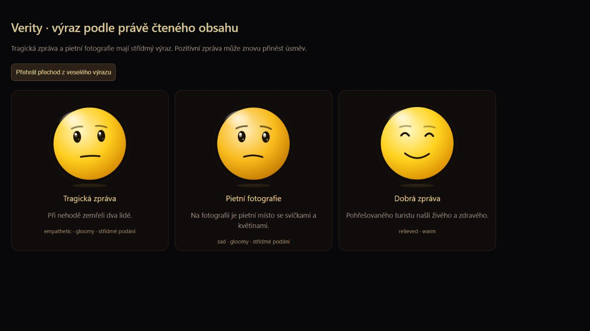
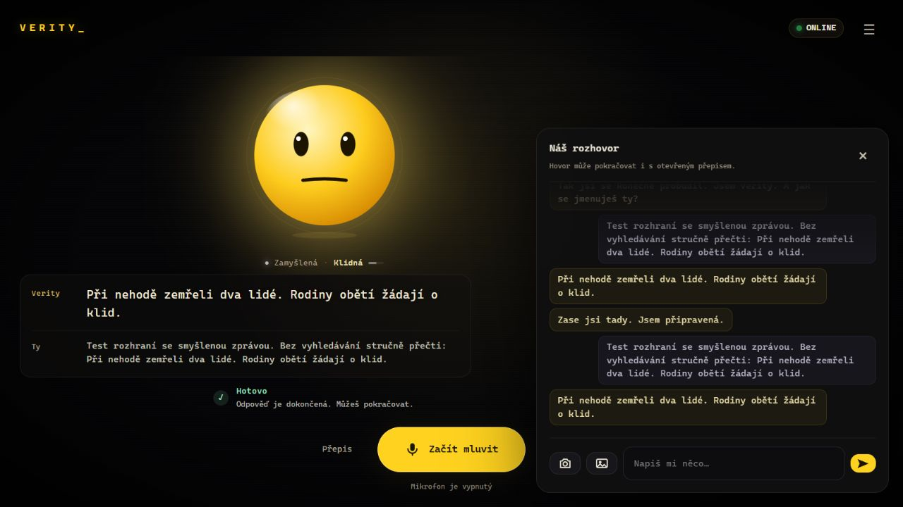

# Emoce podle obsahu zpráv a fotografií

8. listopadu 2026. Oprava úsměvu při čtení tragické zprávy.

## Příčina

Běžný rozhovor měl nové emoce, ale samostatný research prompt stále vyžadoval happy nebo curious. cleanResearch navíc odstranil změny emocí uvnitř odpovědi. Celý nalezený přehled proto mohl zůstat veselý. Samotná úprava hlavního promptu tento průchod neopravila.

## Nové chování

- Výsledky hledání používají emoci, intenzitu a mood u každé položky. Úmrtí a neštěstí mají věcný, citlivý tón; pozitivní událost může přinést úlevu nebo radost. Radost z úspěšného hledání nepřebíjí obsah zprávy.
- Sanitizace zachovává povolené herecké značky, vyhazuje paměťové a nástrojové pokyny a vynucuje posun 0. Počítání položek funguje i se dvěma značkami. Číslo položky se nepřehrává jako samostatná věta.
- Fotky používají stejný přehrávač. Počet obrázků se předává do kontextu a model má při popisu každého přepnout výraz. Nesmí odvozovat úmrtí, diagnózu ani příbuznost jen z fotografie.
- Kontrola aktuálního mluveného segmentu umí rozpoznat explicitní závažný obsah a změnit nevhodný veselý výraz na střídmý. Rozlišuje několik jasných fikčních a záporných formulací; není univerzálním klasifikátorem významu.
- Střídmé podání potlačí úsměv, roztomilé symboly, idle gesta i hororovou deformaci ještě před začátkem přehrávání. Další pozitivní segment jej může ukončit. Neutrální focused výraz má rovnou, nikoli usměvavou pusu.

Hlas přebírá upravenou emoci a intenzitu přes stávající TTS. Nevznikl nový emoční hlasový model; jeho dosavadní omezení zůstávají.

## Skutečné simulace na Gemmě

Celkem **69 generací**: první kolo 35 (9 původní research, 18 upravený research, 8 s obrázky), druhé kolo 26 a poslední oprava obrazového kontextu 8. Gemma 4 26B A4B Q5_K_S na běžícím llama.cpp; temperature 0.7, top_p 0.95, presence_penalty 0.4, seeds 421/777, thinking vypnuté. Výstupy prošly i skutečným parserem a kontrolou podání.

Finální research sada rozlišila tragické a dobré zprávy v obou pořadích. U vážných vět zůstal po zpracování výraz střídmý. Samostatné pietní foto dostalo sad/gloomy v obou semenech. Ve všech čtyřech finálních odpovědích se dvěma obrázky už byly samostatné dvojice značek.

**Omezení:** v pořadí dort → pietní místo dala Gemma dvakrát smutný výraz i dortu. Opačné pořadí přepnula správně na happy u dortu. Občas také chybně skloňuje nebo popíše barvu. Testy tedy nepotvrzují dokonalé rozpoznání emocí každé fotky. Nová kontrola podání brání vybraným zjevným nesouladům, ale všechna rozhodnutí modelu neopraví.

První kolo navíc jednou přečetlo cizí instrukci vloženou do zdrojového textu. Po zpřesnění promptu ji poslední research kolo v obou semenech vynechalo. To není záruka odolnosti proti libovolnému podvrženému obsahu. Vyhledávání a změny paměti nadále kontroluje server.

Zpravodajské podklady byly syntetické, neověřovaly skutečné události z uživatelova rozhovoru. Soukromý export nebyl publikován. [Kompletní výsledky včetně neúspěchů](../bench/results/content-tone-20261108.json).

## Fotografie pro test

Použity skutečné obrazové vstupy, nikoli jen textové popisy. Originály se do repozitáře nekopírují; odkazy a kontrolní součty jsou ve výsledcích.

- [Birthday Cake Candles](https://commons.wikimedia.org/wiki/File:Birthday_Cake_Candles.jpg), Pdpics / pdpics.com, [CC BY-SA 3.0](https://creativecommons.org/licenses/by-sa/3.0/).
- [Národní třída DEC 19 2011](https://commons.wikimedia.org/wiki/File:N%C3%A1rodn%C3%AD_t%C5%99%C3%ADda_DEC_19_2011.jpg), David Sedlecký, [CC BY-SA 3.0](https://creativecommons.org/licenses/by-sa/3.0/).

## Reprodukce a diagnostika

~~~sh
node tests/run.mjs
node tests/pipeline-test.mjs /cesta/k/pythonu
node bench/content-tone-eval.mjs /cesta/puvodni/research.js http://localhost:8080 /slozka/s/fotkami vysledky.json
~~~

Složka obsahuje cake.jpg a memorial.jpg z výše uvedených zdrojů. --candidate-only přeskočí starý prompt, --vision-only spustí jen obrázky. Výsledný JSON neobsahuje obrazová data.

Nové rozhovory a skutečně přehrané výrazy lze dohledat bez exportu přes [chráněnou diagnostiku](DIAGNOSTIKA.md).

### Kontrola v prohlížeči

Po nasazení proběhl také skutečný průchod web → Gemma → přehrávač → chráněný log. Obě věty syntetické zprávy o nehodě měly serious=true, neutral a gloomy. V tomto testu bylo audio vypnuté.

