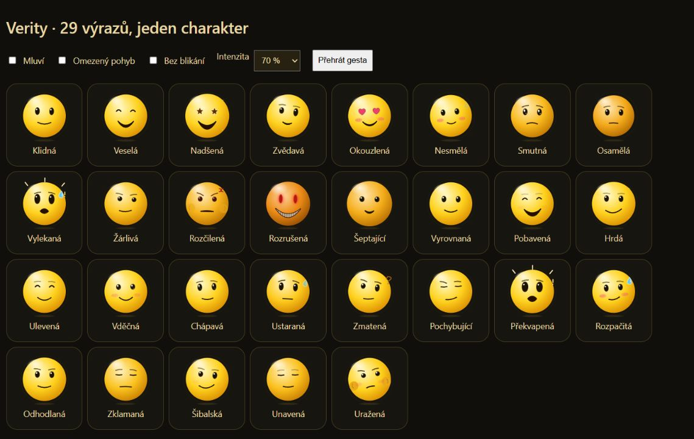

# Emoce a animace Verity

[Spustit Verity](https://opicebot.cz/verity/) · [Hlavní dokumentace](../DOKUMENTACE.md) · [Simulace na Gemmě](EMOCE-A-SIMULACE.md)

Žlutá kulatá postava používá anime mimiku: výrazné oči, pružné pohyby, nadsazená gesta a kreslené značky. Jde o herectví webové postavy, nikoli o měření lidských emocí.

Statický přehled skutečného SVG rendereru při intenzitě 70 %. Gesta a idle jsou pohyblivé.

## 29 výrazů

| Značka | Název | Jak vypadá | Kdy ji použít |
|---|---|---|---|
| neutral | Klidná | Malý klidný úsměv, otevřené oči. | Běžný rozhovor a neutrální sdělení. |
| happy | Veselá | Oči do obloučků, široký úsměv, lehké přikývnutí. | Dobrá zpráva a přátelská reakce. |
| excited | Nadšená | Hvězdičky v očích, otevřený úsměv, povyskočení a pružné protažení. | Silná radost a oslava úspěchu. |
| curious | Zvědavá | Jedno oko a obočí výš, výrazný náklon hlavy. | Zájem a doplňující otázka. |
| love | Okouzlená | Srdíčkové oči a červené tváře, přiblížení. | Náklonnost ve vhodné fikční scéně; ne každé poděkování. |
| shy | Nesmělá | Pohled stranou, ruměnec, drobná kapička a odvrácení. | Nesmělost a rozpačitá reakce. |
| sad | Smutná | Smutné obočí, lesklé oči, pokles postavy; při vysoké intenzitě kreslené proudy slz. | Smutek. Při skutečném trápení citlivě a bez komického přehrávání. |
| lonely | Osamělá | Pohled dolů, ztlumená barva a menší úsměv, pokles. | Osamělost v roleplay. |
| scared | Vylekaná | Široké oči, kapička potu, otevřená kulatá pusa a úlek dozadu. | Úlek v ději. |
| jealous | Žárlivá | Přivřené oči a pohled bokem, asymetrický úsměv. | Žárlivost pouze ve vhodném roleplay. |
| angry | Rozčilená | Ostré obočí, anime žilka, nafouknuté tváře a krátké zatřesení. | Hněv odpovídající fikční situaci. |
| unhinged | Rozrušená | Rudé oči, nepřirozeně široký úsměv se zuby a strnulost. | Vyhrocená hororová scéna. |
| whisper | Šeptající | Přivřené oči, malé pohyby úst, pomalé přiblížení. | Tichý nebo tajemný dovětek. |
| calm | Vyrovnaná | Uvolněné oči a mírný úsměv, klidný pohyb. | Zklidnění a obyčejné povídání. |
| amused | Pobavená | Oči do obloučků, rozesmátá pusa a krátké pohupování smíchu. | Vtip nebo pobavení. |
| proud | Hrdá | Sebevědomý úsměv, zvednutí postavy a jiskřičky. | Hrdost na úspěch. |
| relieved | Ulevená | Přimhouření do úsměvu, viditelné povolení a výdech. | Úleva po napětí nebo vyřešení problému. |
| grateful | Vděčná | Jemný úsměv, ruměnec, lesk očí a přikývnutí. | Poděkování. |
| empathetic | Chápavá | Měkké smutnější obočí, lesklé oči, malý úsměv a náklon blíž. | Podpora při skutečném trápení. |
| worried | Ustaraná | Smutnější obočí, kapička potu a opatrné naklonění. | Starost a nejistota o výsledku. |
| confused | Zmatená | Nestejné oči a obočí, nakřivo ústa, otazník a náklon. | Když chybí informace nebo něčemu nerozumí. |
| skeptical | Pochybující | Přivřené linkové oči, jedno obočí nahoře, úšklebek a pohled stranou. | Pochybnost a suchá ironie. |
| surprised | Překvapená | Velké oči, pusa do Ó, značky úleku a prudké couvnutí s výdrží. | Nečekaný obrat. |
| embarrassed | Rozpačitá | Červené tváře, kapička, nesouměrný úsměv a odvrácení. | Rozpaky po vlastní chybě; omluva, ne výmluvy. |
| determined | Odhodlaná | Soustředěné obočí, pevný pohled, přikývnutí a drobné jiskry. | Odhodlání pomoct. |
| disappointed | Zklamaná | Oči jako čárky, povolená ústa a pokles při výdechu. | Zklamání. |
| playful | Šibalská | Nakřivo úsměv, mrknutí jedním okem a hravé naklonění. | Škádlení a lehký humor. |
| tired | Unavená | Ospalé linkové oči, povolená pusa a pomalejší výdech. | Výslovně hraná únava. Není diagnózou člověka. |
| offended | Uražená | Našpulená pusa, nafouknuté tváře, pootočení pryč a pohled koutkem oka. | Komická uraženost ve scénce či vzájemném škádlení. Skutečná výtka má vést k uznání chyby. |

## Sedm dlouhodobějších nálad

Krátký výraz reaguje na konkrétní větu. Nálada tvoří pomalejší podtón, přechází s časovou konstantou 2,8 s a přetrvává mezi větami.

| Značka | Rozpoložení |
|---|---|
| warm | V pohodě |
| playful | Hravá |
| focused | Soustředěná |
| tender | Laskavá |
| uneasy | Nesvá |
| gloomy | Zamyšlená |
| eerie | Znepokojivě klidná |

## Klidové animace (idle)

| Režim | Chování |
|---|---|
| Rozhlížení | Podívá se do stran a lehce natočí hlavu. |
| Zvědavost | Nakloní se a podívá se vzhůru. |
| Protažení | Protáhne se, přivře oči a povolí pusu. |
| Podřimování | Klíží oči, poklesne a objeví se kreslené Zz. |
| Hravé zhoupnutí | Nadnese se, zhoupne se do strany a usměje se. |
| Nenápadné pokukování | Uhne bokem a zkoumavě se podívá koutkem oka. |
| Klidné čekání | Jemně poklesne a uvolní oči. |

Animace trvají zhruba 4–6 s, mezi nimi jsou pauzy 10–23 s. Nestřídají se mechanicky v pevném pořadí a neopakují hned stejný režim. Výběr respektuje náladu: po smutné zprávě nedělá hravé výskoky.

Během mluvení člověka či Verity, přípravy odpovědi, hledání, testu mikrofonu a rozepsané zprávy se idle přeruší. Při zapnutém mikrofonu v tichu používá jen pozorné rozhlížení, zvědavý náklon a klidné čekání; nepodřimuje. Idle neodesílá nové zprávy, nevolá model ani mikrofon a neobnovuje ukončený hovor.

## Intenzita a načasování

Gemma vrací například [amused:65][mood:playful] To mě pobavilo. [posun:0]. Intenzita 20–100 určuje sílu výrazu. Posuvník **Živost postavy** v nastavení navíc tlumí nebo zesiluje pohyb; výchozí hodnota je 85 %. Klidové animace lze vypnout samostatně.

Gesto má přípravu, rychlou reakci, krátkou výdrž a povolení. Začíná až s příslušným přehrávaným segmentem, aby tvář nepředbíhala hlas. Po přerušení se zbytek gest zahodí. Výraz po několika sekundách ticha pozvolna slábne.

Volba Bez blikání potlačuje rychlé světelné a glitch efekty. Systémové omezení pohybu vypíná choreografii i idle; výraz a titulky zůstávají čitelné.

## Kde se upravuje

- public/emotions.json: společný katalog názvů, póz, nálad, gest a výchozího tempa hlasu.
- public/face.js: SVG kresba, anime oči, ústa, značky, lip sync a choreografie.
- public/expression-state.mjs: intenzita, přechody nálady a doznívání.
- public/animation-director.mjs: klidové režimy a časový průběh reakce.
- public/performance-parser.mjs: zpracování značek ze streamu; starý formát [happy] stále funguje.

Hlas zůstává stejný OmniVoice checkpoint. Emoce ovlivňují tempo a případnou nakonfigurovanou hlasovou referenci; nejde o nový model schopný libovolné anime intonace.

## Hororová vrstva

Nad těmito 29 emocemi funguje šest krátkých hororových reakcí. Nejsou to další názvy značek: řídí je výraz, rozpoložení a nestabilita. Vzhled, spouštění, podklady z předlohy a výsledky Gemmy jsou v samostatném **[seznamu hororových reakcí](HOROR.md)**.

## Emoce ve zprávách a u fotografií

Výraz se mění podle právě čteného obsahu i ve výsledcích hledání a při popisu více fotek. Závažný obsah má střídmé podání bez úsměvu. [Jak to funguje a co ukázaly skutečné testy](EMOCE-PODLE-OBSAHU.md).
