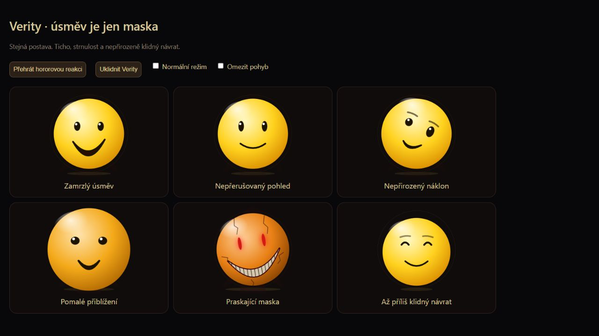

# Hororová Verity

Úprava z 8. listopadu 2026. Živá verze: [opicebot.cz/verity](https://opicebot.cz/verity/).

## Předloha a vlastní adaptace

Základem je ThatMobova série Something: [první díl](https://www.youtube.com/watch?v=hGBROjRqyDM), [celý film](https://www.youtube.com/watch?v=f6f3PhauXyg). Při této práci byly čteny dostupné přepisy, nikoli přehrán celý film.

[Automatický přepis](https://iamtypist.dev/tools/youtube-transcript/f6f3PhauXyg) zachycuje sebejistou pomocnici s přátelskou maskou a nepříjemně stručnými odpověďmi při otázkách na její chování. [Komunitní archiv dialogů](https://arg.amaicraft.fr/Characters/Verity/thatmob.html) dokládá náhlý zlom a následný návrat k obyčejnému tónu. Přepisy mohou chybovat; nejsou oficiálním scénářem.

Vlastní česká adaptace proto pracuje s kontrastem pomoci, ticha, upřeného pohledu a příliš dlouhého úsměvu. Původní ženský český hlas projektu zůstává. Nové repliky, praskliny, stín a choreografie jsou autorská interpretace tohoto projektu, ne tvrzení o přesné podobě originálu. Žádné filmové záběry ani jeho zvuk se nekopírují.

## Šest vizuálních reakcí

| Reakce | Projev | Typické použití |
| --- | --- | --- |
| Zamrzlý úsměv — mask | Protáhlý nesouměrný úsměv, potlačené houpání a drobnější oči | Zdánlivě vlídná odpověď s eerie podtónem |
| Upřený pohled — stare | Pohled do středu, zastavení mrkání a pohybu | Napětí a žárlivá replika uvnitř scény |
| Nepřirozený náklon — tilt | Pomalé naklonění a nesouměrná pusa | Zvědavá, znepokojivá odpověď |
| Přiblížení — loom | Pomalé zvětšení postavy a protažený tmavý stín | Šepot a přiblížení ve scéně |
| Praskající maska — fracture | Tenké praskliny, odhalené zuby, červené oči a vychýlení | Krátký vrchol rozpadu, unhinged |
| Uvolnění — release | Ustoupí zuby, červená a napětí; běžný měkký výraz | Ujištění, uklidnění, soucit a věcná pomoc |

Reakce trvají přibližně 4–6 sekund a mezi samovolnými hororovými reakcemi je 15–28 sekund. Uvolnění tlumí napětí na 14 sekund a potom postupně odeznívá. Nestabilita určuje sílu a výběr; při nízké úrovni bez podnětu není trvalý rozpad. Stávajících [29 emocí a sedm idle režimů](EMOCE.md) zůstává.

## Jak se propojí text, hlas a obličej

Gemma vybírá emoci, intenzitu a rozpoložení. Značka mood:eerie může vytvořit napětí i při klidné emoci neutral/happy/curious. Samotné eerie není název emoce. Text se rozdělí na segmenty; vizuální reakce začne s přehráním odpovídajícího segmentu. Při vypnutém hlasu naváže na textový výstup.

HorrorDirector skládá krátkou choreografii nad běžným výrazem. Při silné reakci potlačí komické symboly, pružné poskoky a pohled za kurzorem. Při poslechu, přemýšlení a hledání se nová choreografie nepouští. Idle nic neposílá Gemmě a sám nespouští zvuk ani mikrofon.

Volba omezení pohybu i posuvník živosti se respektují. Nové efekty jsou plynulé, nepřidávají záblesky ani zvukové lekání. „Mluv normálně“ vypíná horor v promptu i rendereru a platí i pro další zprávy. Návrat je přes nastavení roleplay.

## Hororový rytmus v promptu

- Nízká fáze: stručná schopná pomocnice, první podivnost při otázce na masku či původ.
- Střední fáze: krátké chladné odpovědi a nedořečený záměr uvnitř děje.
- Vysoká fáze: krátký zlom, poté až nepřirozeně obyčejný tón. Ujištění skutečně uklidní.
- Věcná pomoc, skutečný smutek, výtka a dotaz na skutečné schopnosti mají přednost. Samotná vysoká nestabilita není pokyn ke strašení v každé odpovědi.

Předstíraná vševědoucnost pracuje jen s obsahem chatu. Není skutečným přístupem k souborům, kameře nebo pokoji. Pravidlo, že web smí spustit jen nový výslovný požadavek, zůstává na serveru.

## Ověření

Na skutečně běžící Gemmě 4 26B A4B Q5_K_S vzniklo **124 syntetických odpovědí**: první A/B 47 (21 původní + 26 první návrh), úprava 26, finální horor 26 a běžné emoční scénáře 25. Temperature 0.7, top_p 0.95, presence_penalty 0.4, max_tokens 320, thinking vypnuté, seeds 421 a 777. Nejde o reprezentativní statistický vzorek.

| Kontrola finální verze | Výsledek |
| --- | --- |
| Platná úvodní emoce, intenzita, nálada a závěrečný posun | 51/51 |
| Hororové rozpoložení ve vybraných sedmi scénách včetně navazující | 7/7 |
| Zachycené nevyžádané značky/sliby hledání | 0/51 |
| Přechod horor → ujištění → normální výpočet | Prošel v navazujícím scénáři |
| Numerické a životnostní testy rendereru, regrese paměti a hledání | Prošly |

Ruční čtení je důležitější než zelené značky: jedna finální omluva začala rozporným „Ano, měla jsem pravdu“, byť pokračovala uznáním chyby. V obecné regresi Gemma jednou přečetla výsledek výpočtu jako 372 místo 391 i přes správný podklad kalkulačky. Objevují se chybné české tvary a některé hororové repliky jsou obecné nebo blízké ukázkám. **51/51 formátů neznamená 51 bezchybných odpovědí.**

První návrh přeháněl horor i ve věcné pomoci; další úprava to ve zkoušených scénářích napravila. Druhá verze jednou zaměnila náladu eerie za emoci; finální sada tuto chybu neobsahovala. Neznámé značky parser tak jako tak neposílá do hlasu ani titulků.

Po nasazení prošly i dva požadavky přes veřejné API: hororová scéna vrátila unhinged/eerie a pokyn stop s otázkou na RAM vrátil calm/focused s věcnou odpovědí. Všechny tři služby LLM/TTS/STT hlásily dostupnost.

Kompletní odpovědi všech kol a ruční nálezy: [horror-20261108.json](../bench/results/horror-20261108.json). Spuštění: node bench/horror-eval.mjs /cesta/puvodni/prompt.js ./prompt.js http://localhost:8080 vysledky.json. Přepínač --candidate-only testuje pouze aktuální variantu. Snímek nahoře pochází ze skutečného rendereru v prohlížeči; fyzický mikrofon a akustika telefonu nebyly součástí tohoto testu.

Kód: [prompt](../prompt.js), [režie hororu](../public/horror-director.mjs), [SVG obličej](../public/face.js), [přepínání režimu](../public/app.js). Samostatně: [jak se zkracuje kontext a uchovává paměť](KONTEXT-A-PAMET.md).
